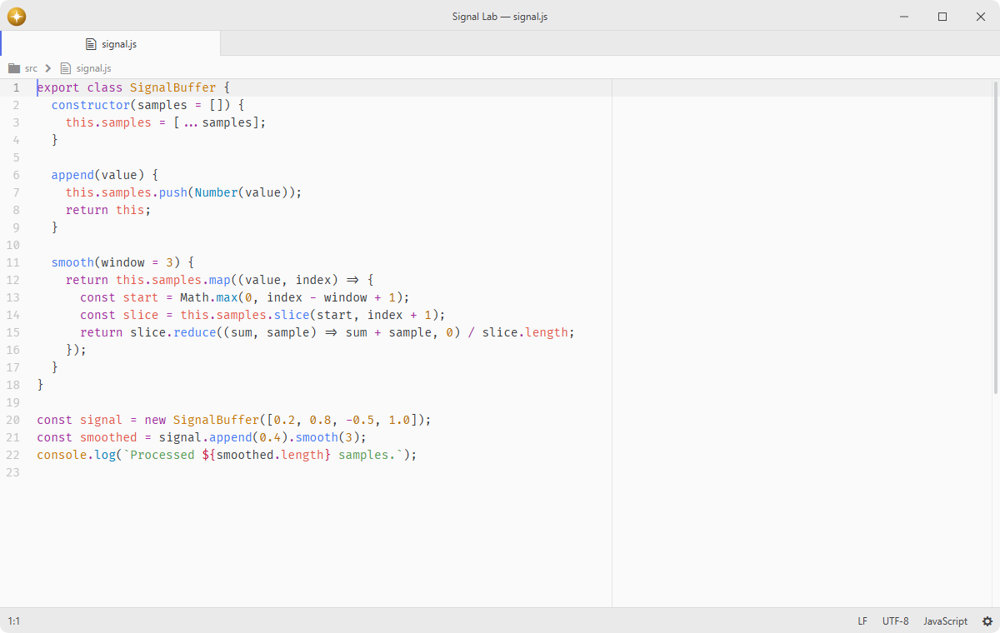

# wrap-guide

Displays a vertical line in the editor to guide line length.

Fork of [pulsar-edit/pulsar](https://github.com/pulsar-edit/pulsar) (`packages/wrap-guide`).

## Features

- **Wrap guide line**: places a vertical line at a column so lines do not exceed a chosen width.
- **Preferred line length**: follows the editor's effective preferred line length, including per-language settings and editor overrides.
- **Soft wrap boundary**: can follow the editor's actual wrap column as the window width and wrap limits change.
- **Multiple guides**: shows several independent visual guides at custom columns without changing the editor's preferred line length.
- **Scoped control**: enables or disables the guide per language through scoped configuration.
- **Styling**: lets you change the guide's color and width with your own CSS.



## Installation

To install `wrap-guide` search for it in the Install pane of the Lumine settings, or run the command `lumine --install lumine-code/wrap-guide`.

## Configuration

Disable the guide for a particular language through scoped configuration in your `config.json`. For example, to turn it off for GitHub-Flavored Markdown:

```json
{
  ".source.gfm": {
    "wrap-guide": {
      "enabled": false
    }
  }
}
```

Show multiple guide lines by listing the columns. These visual guides remain independent of `editor.preferredLineLength`; changing either setting preserves the other. Leave the list empty to follow the editor's effective preferred line length:

```json
{
  "wrap-guide": {
    "columns": [72, 80, 100, 120]
  }
}
```

## Customization

Change the guide's themeable color and width by adding CSS to your `styles.css`:

```css
:root {
  --wrap-guide-color: red;
}

lumine-text-editor .wrap-guide {
  width: 10px;
}
```

## Services

- `background-tips.provider`: provided to Background Tips to describe configurable ruler columns.

## Contributing

Got ideas to make this package better, found a bug, or want to help add new features? Just drop your thoughts on GitHub. Any feedback is welcome!
